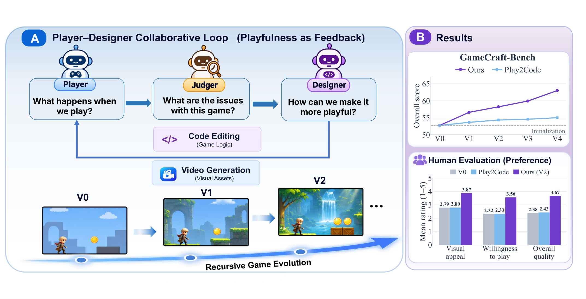

# Play2Evolve

### Playfulness as Feedback for Agentic Game Development

[Project page & video demos](https://play2evolve-project-preview.steadydrake257.chatgpt.site) ·
[Method](https://play2evolve-project-preview.steadydrake257.chatgpt.site/#method) ·
[Results](https://play2evolve-project-preview.steadydrake257.chatgpt.site/#results)

## TL;DR

**Play2Evolve combines video generation with game code to build playable games,
then uses agent playtesting to evolve both together.** Video models generate
appearance and motion; code provides interaction, rules, and game state.
Player, Judge, and Designer agents turn gameplay evidence into coordinated
changes to visual materials and executable logic.

- **Build:** turn a game brief into a runnable game with generated materials.
- **Refine:** playtest, diagnose defects, and repair visuals and code together.
- **Evolve:** propose new gameplay and aesthetic goals, implement upgrades, and test the next version.

<p align="center">
  <a href="docs/media/teaser.png">
    
  </a>
</p>

## About this branch

`project-page` contains only the static research website and its media assets.
The implementation and setup documentation remain on the
[`main` branch](https://github.com/showlab/Play2Evolve/tree/main).

The website includes gameplay recordings, stage comparisons, successive evolution
demos, method figures, and manuscript results. Every video has independent
**0.25× / 0.5× / 0.75× / 1×** playback controls. Demo recordings are illustrative
checkpoints, not frame-matched A/B tests or the full benchmark cohort.

## Preview locally

No build step or package installation is needed. From the repository root:

```bash
python3 -m http.server 8000 --directory docs
```

Open **http://localhost:8000**. The page plays recorded demos; it does not run the
games in your browser.

## Website files

```text
README.md          Project overview and preview instructions
 docs/
   index.html      Page content and structure
   styles.css      Dark theme and responsive layout
   page.js         Video controls, navigation, and motion
   media/          Videos, posters, and paper figures
   .nojekyll       Static-file support for GitHub Pages
   README.md       Website editing and hosting notes
```

Edit `docs/index.html`, `docs/styles.css`, or `docs/page.js` and refresh the local
preview. Keep media paths relative so the page works under a GitHub Pages project
path as well as at the root of a host. See [website notes](docs/README.md) for
hosting details.

## Release status

Paper metadata, author details, and release links are forthcoming. No open-source
license has been selected; this branch does not grant redistribution rights beyond
those already held by the respective owners.
