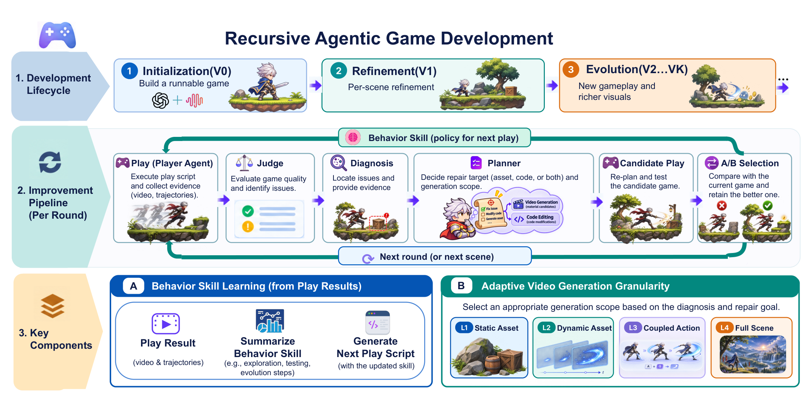

# Playfulness as Feedback for Agentic Game Development

> **Weijia Mao<sup>1</sup>**, Kevin Qinghong Lin<sup>1</sup>, Zhen Fang<sup>2</sup>,
> Danze Chen<sup>1</sup>, Dongxing Mao<sup>1</sup>, and Mike Zheng Shou<sup>1</sup>*
>
> <sup>1</sup> Show Lab, National University of Singapore · <sup>2</sup> University of Science and Technology of China
>
> *Corresponding author*

<p align="center">
  <a href="https://showlab.github.io/Play2Evolve/">🌐 Project Page</a>
  &nbsp;&nbsp;•&nbsp;&nbsp;
  <a href="https://github.com/showlab/Play2Evolve">💻 Code</a>
  &nbsp;&nbsp;•&nbsp;&nbsp;
  📄 arXiv <em>(coming soon)</em>
</p>

## ✨ Abstract

**Play2Evolve** combines video generation models with executable game code and
treats playfulness as feedback. Agents play generated games, turn observations
into diagnoses, and recursively improve visual materials, game logic, and
gameplay. This repository packages the GameCraft/Godot and GameASG/HTML
implementations in one Python source tree.

**Release preparation:** the source has been extracted from a research workspace.
See [validation](docs/validation.md) for checks actually performed and
[release checklist](docs/release_checklist.md) for remaining publication work.
No open-source license has been selected yet; this preparation copy does not grant
redistribution rights beyond those already held by the respective owners.

## 🗓️ Timeline

- **November 24, 2026:** planned public release of the Play2Evolve code and
  project page, subject to the final release checks.

## 💡 Tips

- Agent-authored code can fail for several reasons, including environment
  differences, limitations of the agent, and small bugs in the generated or
  integration code. We will continue improving the implementation and welcome
  issue reports, suggestions, and other feedback.
- Some failure cases are expected and are discussed in the paper. For example,
  an agent may write an invalid call to an interface, which can cause the game
  program or a downstream evaluation step to fail. When reporting a result,
  please include the relevant logs and configuration so that we can reproduce it.

## 🎮 Play2Evolve at a glance

The teaser summarizes the central idea: playtest feedback drives coordinated
updates to generated video materials and executable game code.

<p align="center">
  <a href="docs/media/teaser.png">
    
  </a>
</p>

The pipeline shows how initialization, refinement, and evolution repeat the
play, judge, diagnosis, planning, candidate-play, and selection loop. Video
generation controls appearance and motion. Game code controls input, state,
collision, progression, and outcomes.

<p align="center">
  <a href="docs/media/pipeline.png">
    
  </a>
</p>

## 🔁 Pipeline

1. **Game Initialization:** a builder turns a public game brief into a game package,
   using video generation as a tool and checking the generated project.
2. **Game Refinement:** playtest scenario groups, diagnose issues, plan repairs,
   execute code/material candidates, and compare their replays. Program-mode
   examples use three groups and three rounds per group.
3. **Game Evolution:** plan a gameplay and/or aesthetic upgrade, implement it over successive
   rounds, and evaluate the resulting game through playtests. Behavior Skill and
   Video Skill are separate components.
4. **Showcase and evaluation:** export final-game demonstrations and invoke the
   external benchmark evaluator. Internal selection is distinct from
   benchmark scoring.

The copied core keeps the original `gamecraft_*` module names. The public
`play2evolve` command dispatches to those implementations; it does not introduce
another optimization algorithm. See [stage naming](docs/architecture.md#stage-naming)
for the mapping to retained internal names.

## 🧩 Choose a backend

| Backend | Game runtime | Three stage commands | Scoring |
| --- | --- | --- | --- |
| Craft (default) | Godot | `initialization`, `refinement`, `evolution` | GameCraft-Bench |
| GameASG | Browser, self-contained HTML | `asg initialization`, `asg refinement`, `asg evolution` | GameASG-Bench Docker L1/L2 |

Both adapters retain their existing execution and selection logic. Browser
playtesting does not use the Godot recorder. Only install the system dependencies
for the backend you intend to run.

## 🛠️ Installation

Linux and Python 3.12+ are required. Craft needs Godot 4, FFmpeg/ffprobe,
Xvfb and xdotool on `PATH`. Recorded OS-input evaluation uses X11. GameASG
needs Linux x86-64, a working Docker daemon, FFmpeg and the pinned benchmark
image (see below); its browser and Node.js run inside that image.
Install Codex CLI and authenticate using your own account if selecting the Codex
backend. No credentials or model weights are included.

```bash
python3 -m venv .venv
source .venv/bin/activate
python -m pip install -e '.[dev]'
```

For **Craft**, install GameCraft-Bench separately from a checkout you are authorized to use:

```bash
export GAMECRAFT_BENCH_ROOT=/absolute/path/to/GameCraft-Bench
python -m pip install -e "$GAMECRAFT_BENCH_ROOT"
export GAMECRAFT_BENCH_GODOT_BIN=/absolute/path/to/godot
export H3_URL=http://127.0.0.1:30010
export LLM_BACKEND=codex
export OPTIMIZER_BACKEND=codex
play2evolve doctor
```

The benchmark is also used by replay and final-showcase code. Keep the same
checkout throughout a run. `docs/dependencies.md` records the source revision
used during extraction. A functioning H3 service is needed for actual material
generation; Play2Evolve does not start or replace GPU services automatically.

## 🎞️ Configure H3 video generation

Start or obtain an H3-compatible HTTP service **before** running generation.
This repository contains the client, not the H3 weights, inference environment
or serving deployment. The service may run on the same host or a remote GPU host.
The URL must be reachable from the machine executing the asset Python process;
`127.0.0.1` refers to that machine, not your laptop or development machine.

```bash
export H3_BACKEND=local
export H3_URL=http://127.0.0.1:30010  # base URL, without /v1 or a trailing slash
export GAMECRAFT_H3_JOB_TIMEOUT_SECONDS=3600
export GAMECRAFT_ASSET_PYTHON="$(command -v python)"

# Run on the actual execution host; these checks do not generate video.
curl --noproxy '*' --fail --max-time 10 "$H3_URL/health"
curl --noproxy '*' --fail --max-time 10 "$H3_URL/v1/videos"
```

`local` is the name of the HTTP adapter; it can connect to a remote server.
The service must implement this project's request schema and job endpoints;
an arbitrary SGLang endpoint or hosted video API is not automatically compatible.
For an existing remote service, replace the host in `H3_URL`. GPU count, model
placement and distributed inference are **server-side** settings. Eight-card
inference cannot be enabled by changing the client URL or asset parallelism.

| Setting | How to use it |
| --- | --- |
| `H3_URL` | Base address for the `local` adapter. Craft Initialization records it at `prepare`; Refinement/Evolution inherit the environment. |
| `--h3-url` | Explicit address for Craft Initialization and GameASG commands. GameASG defaults to localhost, so pass `--h3-url "$H3_URL"`. |
| `--h3-backend local` | Explicit Craft backend selection. The GameASG integrated material worker currently uses `local`. |
| `GAMECRAFT_H3_JOB_TIMEOUT_SECONDS` | Craft material job polling budget, including server queue time; default 1200 seconds. |
| `--h3-timeout` | GameASG material timeout; default 3600 seconds. The worker exports it as the effective job timeout. |
| `--asset-python` | Python with Play2Evolve and media dependencies installed, able to reach the service. It need not load H3 weights for the HTTP backend. |
| `--asset-parallelism 1 --asset-candidates 1` | Craft repair candidate budgets, not the number of inference GPUs or a global retry limit. |

Configure the H3 server's default to **50 inference steps** for these examples.
Craft's default requests omit the step count and use that server default.
GameASG's `--h3-steps 50` also uses the server default in the retained worker;
nondefault values override text-to-video requests. Confirm the effective steps
from server configuration/logs rather than assuming a client flag enforces them.

`play2evolve doctor` checks local tools/imports, not H3 generation. Before a long
run, follow [the H3 guide](docs/h3.md) to generate a single clip, verify the MP4,
and check timeout, conditioning-file and multi-GPU requirements. For a custom
endpoint requiring authentication, the current local adapter needs an appropriate
adapter/proxy; it does not send bearer credentials by default.

## 🧱 Run Craft: the three stages

Run from this repository root after installation. Replace model names if your
account uses another model; keep the player, judge and editor choices explicit.
Each command below calls real services except `initialization prepare`.

### 🌱 1. Initialization — generate the game

```bash
play2evolve initialization prepare \
  --instruction examples/lake-flight/instruction.md \
  --workspace outputs/lake/initialization --bootstrap-only --demo-only \
  --model gpt-6-sol --video-skill \
  --h3-backend local --h3-url "$H3_URL" \
  --godot "$GAMECRAFT_BENCH_GODOT_BIN" --asset-python "$(command -v python)"
play2evolve initialization run --workspace outputs/lake/initialization
```

`--bootstrap-only` keeps this stage separate from refinement. After it finishes,
read the actual package path (do not pass the workspace itself as a package):

```bash
INITIALIZED_PACKAGE=$(python - <<'PYCODE'
import json
from pathlib import Path
root = Path('outputs/lake/initialization').resolve()
s = json.loads((root / 'state.json').read_text())
assert s['stage'] == 'bootstrap_ready', s['stage']
p = Path(s['package'])
print(p if p.is_absolute() else root / p)
PYCODE
)
```

### 🔧 2. Refinement — three groups, three rounds per group

```bash
play2evolve refinement \
  --game-package "$INITIALIZED_PACKAGE" --output outputs/lake/refinement \
  --rounds 3 --initialization-playtest program --initialization-group-count 3 \
  --initialization-behavior-skill --player-state engine \
  --player-backend codex --player-model gpt-6-sol \
  --judge-backend codex --judge-model gpt-6-sol \
  --composition-mode codex --codex-model gpt-6-sol \
  --video-skill --asset-candidates 1 \
  --godot "$GAMECRAFT_BENCH_GODOT_BIN" --asset-python "$(command -v python)"
```

This is up to nine repair rounds across three playtest groups. Review the final
reports, then obtain the next input from `result.json`:

```bash
REFINED_PACKAGE=$(python - <<'PYCODE'
import json
from pathlib import Path
r = json.loads(Path('outputs/lake/refinement/result.json').read_text())
print(r['package'])
PYCODE
)
```

### 🚀 3. Evolution — one upgrade cycle with three repair rounds

```bash
play2evolve evolution \
  --game-package "$REFINED_PACKAGE" --output outputs/lake/evolution \
  --rounds 3 --rsi-mode upgrade --player-mode program --player-state engine \
  --player-backend codex --player-model gpt-6-sol \
  --judge-backend codex --judge-model gpt-6-sol \
  --composition-mode codex --codex-model gpt-6-sol \
  --video-skill --asset-candidates 1 \
  --godot "$GAMECRAFT_BENCH_GODOT_BIN" --asset-python "$(command -v python)"
```

For another evolution cycle, use `--continue-from-rsi outputs/lake/evolution`
instead of `--game-package`, with a **new** output directory. This is distinct
from refinement's three groups. See [Craft workflow](docs/workflow.md) for
showcase export, benchmark scoring and additional options. Lake Flight is a
custom example without an official benchmark rubric; official scoring requires
a benchmark task's public instruction and exact task ID.

## 🌐 Run GameASG: the three stages

Obtain a GameASG-Bench checkout separately. The adapter requires revision
`6427cb6517ce11ff350ec45fcae17b67c5aec245` and unchanged tracked files.
It is not bundled here. With Docker already running:

```bash
export GAMEASG_BENCH_ROOT=/absolute/path/to/GameASG-Bench
play2evolve asg environment install --bench "$GAMEASG_BENCH_ROOT"
play2evolve asg environment check --bench "$GAMEASG_BENCH_ROOT"
```

`install` reuses or builds `gamebench-env:v2.0`; it can take time and download
image dependencies. It does not start a daemon unless explicitly requested.
Craft's `doctor` is not the environment check for this backend.

Configure the shared arguments in **Bash**, using your own authenticated Codex
home. Run all three stages in this shell; keep these values unchanged when
resuming a workspace:

```bash
export ASG_CODEX_HOME=/absolute/path/to/your/authenticated/codex-home
export H3_URL=http://127.0.0.1:30010
ASG_COMMON=(
  --bench "$GAMEASG_BENCH_ROOT" --task garden-gulp
  --codex-home "$ASG_CODEX_HOME" --codex "$(command -v codex)"
  --codex-provider openai --model gpt-6-sol
  --asset-python "$(command -v python)" --h3-url "$H3_URL"
  --h3-steps 50 --h3-timeout 3600
  --docker "$(command -v docker)" --image gamebench-env:v2.0
  --groups 3 --rounds 3 --play-seconds 120 --max-actions 240
)
```

The asset Python must have this package installed. No project-specific account
is selected by default; `--expected-account-hash` is an optional identity check.
For a nondefault Docker daemon, also add `--docker-host YOUR_DAEMON_URI` to the
shared arguments and the environment commands.

```bash
# 1. Initialization: generate and export the initial HTML game.
play2evolve asg initialization "${ASG_COMMON[@]}" \
  --output outputs/asg/garden-gulp/base

# 2. Refinement: resume THAT SAME workspace, three rounds per group.
play2evolve asg refinement "${ASG_COMMON[@]}" \
  --output outputs/asg/garden-gulp/base

# 3. Evolution: take the completed workspace, write a NEW cycle directory.
play2evolve asg evolution "${ASG_COMMON[@]}" \
  --source outputs/asg/garden-gulp/base \
  --output outputs/asg/garden-gulp/evolution-01
```

Run each stage only after the preceding command succeeds and its reports have
been inspected. Initialization generates and validates the package; grouped
playtesting and Behavior Skill updates begin in refinement. Each evolution
cycle builds an upgrade, then runs up to three repair rounds, not three groups.

| Stage | Checkpoint | Playable export |
| --- | --- | --- |
| Initialization | `base/initialization.json` (`bootstrapped`) | `base/exports/bootstrap/game/index.html` |
| Refinement | `base/initialization.json` | `base/exports/final/game/index.html` |
| Evolution | `evolution-01/rsi.json`, `result.json` | `evolution-01/exports/final/game/index.html` |

Checkpoint and export names retain their legacy spelling. A completed run can
report coverage gaps; completion alone is not a benchmark pass. Evolution's
`--source` needs the **whole workspace**, not `exports/final` or an HTML file.
See [GameASG operation guide](docs/gameasg.md) for interrupted-run recovery,
additional evolution cycles, scoring, and output inspection.

## ⚙️ Configuration and compatibility

Copy `configs/environment.example.toml` to `configs/local.toml` and replace
paths to use `play2evolve --config configs/local.toml COMMAND ...`. Existing
environment variables take precedence. The GameASG examples pass service and
tool settings explicitly; keep required stage arguments even when using TOML.
Keep credentials in the model client's login store or environment, not TOML.

The old `bootstrap`, `initialize`, and `rsi` commands remain aliases for
`initialization`, `refinement`, and `evolution`. Internal flags such as
`--initialization-playtest` and `--rsi-mode` retain their meaning. See
[stage naming](docs/architecture.md#stage-naming) before using historical scripts.

## 🧭 TODO

- [ ] Continue organizing and preparing the Craft game packages for release.
- [ ] Add the arXiv URL once the preprint is posted.
- [ ] Select and add the final open-source license and release metadata.

## 📦 Repository

- `src/game_initialization/`: requirements, builder tools, game-package construction.
- `src/gamecraft_training/package/`: refinement, evolution, candidate selection, final showcase.
- `src/gamecraft_behavior/`: players, reactive policies, Godot bridge, input recording/replay.
- `src/gamecraft_assets/` and `src/gamecraft_composition/`: material generation and game integration.
- `src/gamecraft_video_skill/`: generation rules and material-boundary decision memory.
- `src/gamecraft_evaluation/`: replay collection, showcase coverage, benchmark adapters.
- `src/gameasg/`: HTML generation, grouped refinement, evolution, browser playtesting and Docker scoring.
- `src/play2evolve/`: portable configuration and CLI.
- `tests/`: retained GameCraft tests and release-portability checks.

Source provenance is recorded in `docs/source_snapshot.json`. Original game
outputs, private account routing, model environments, and Play2Code
baselines are excluded. Historical per-game SkillOpt entry points are not part
of this release; some example/adaptation helpers remain as internal dependencies.

## ✅ Verification

```bash
python -m pytest -q
python -m build
```

Tests use mocks or fixtures for model calls. Engine integration tests require
Godot and the benchmark; one browser policy test requires host Node.js. Neither
the full live Godot pipeline nor the live Docker pipeline was run for this release; consult the validation report for skipped or failing
checks. Game packages contain executable adapter code and should come from
trusted sources.

## 📚 Citation

If you use Play2Evolve in your research, please cite the project as follows:

```bibtex
@article{play2evolve2026,
  title   = {Playfulness as Feedback for Agentic Game Development},
  author  = {Mao, Weijia and Lin, Kevin Qinghong and Fang, Zhen and Chen, Danze and Mao, Dongxing and Shou, Mike Zheng},
  year    = {2026},
  url     = {https://github.com/showlab/Play2Evolve},
  note    = {arXiv link forthcoming}
}
```
